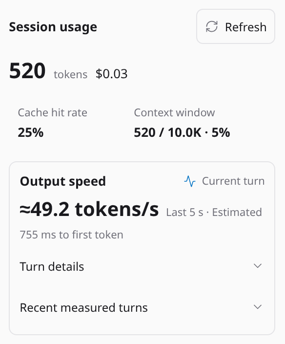
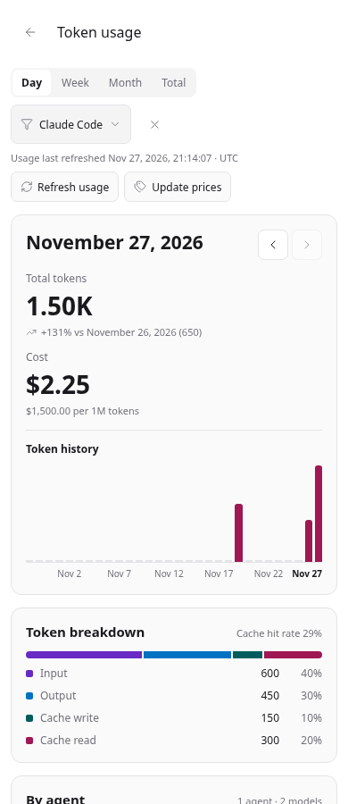

# ccusage-stats

Token usage and estimated cost of your coding agents, powered by ccusage.

<picture>
  <source media="(prefers-color-scheme: dark)" srcset="preview/session-dark.png">
  
</picture>

See [OVERVIEW.md](OVERVIEW.md) for what it shows, how it works and its limits.

## Filter the report by agent

Open the full **Token usage** report and use **All agents** next to the period controls. Pick a source such as Codex or OpenCode. The totals, estimated cost, history, model breakdown, and sessions follow that choice. The filter stays selected when you change the period or refresh usage. Use the clear button to return to the combined report.



## Install

```bash
paseo plugin install github:ms903/paseo-kit:plugins/ccusage-stats
```

Or from a local clone of [paseo-kit](../../README.md):

```bash
cd plugins/ccusage-stats && npm install
paseo plugin install "$PWD"
```

Requires Paseo 0.11.1 or later with plugins enabled on the daemon.

## Develop

```bash
npm run typecheck
paseo plugin reload ccusage-stats
paseo plugin logs ccusage-stats
```

### Try the smaller native scanner

Run `npm run build:scanner` in the plugin directory registered with the Paseo daemon. The build uses Node.js, Git, curl, rustup, and a C toolchain. It takes the ccusage version from `package.json`, checks out the matching upstream tag, and builds the offline JSON entry point with the upstream Rust toolchain, Cargo lockfile, and pricing snapshots. The plugin selects the resulting executable for that version. A normal plugin install uses the platform binary from npm.

To update the scanner, update the exact npm dependency and its lockfile. The scanner workflow rebuilds the entry point against that same release and compares its daily and session JSON with the official package on a test fixture. Run `npm run check:scanner` in a test environment to repeat the comparison.
